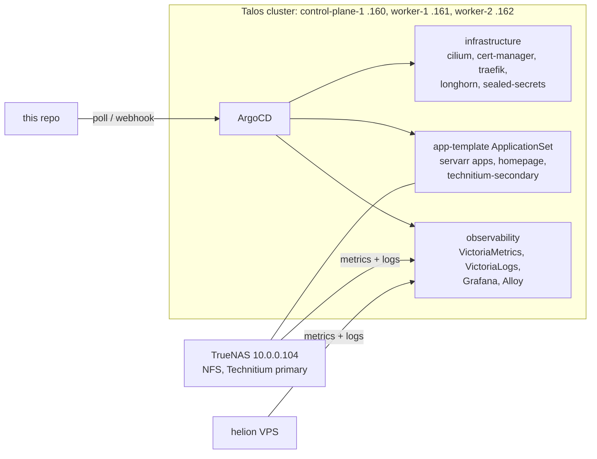

# talos-homelab

A three-node [Talos Linux](https://www.talos.dev) cluster run entirely from this repository with [ArgoCD](https://argoproj.github.io/cd/). After bootstrap, every change is a commit: ArgoCD notices it and reconciles the cluster. Versions are not listed here because [Renovate](https://docs.renovatebot.com) bumps them weekly; the source of truth is each Application's `targetRevision`.



## Layout

```text
bootstrap/talos-cluster.yaml   root Application (applied once); owns everything under deployments/
deployments/
  infrastructure/              one folder per platform component: app.yaml + values + extra manifests
    observability/             VictoriaMetrics stack (Grafana, alert rules, dashboards), VictoriaLogs, Alloy
  apps/
    appset-servarr.yaml        ApplicationSet: one element per app-template app
    _common-values.yaml        values merged under every appset app
    <app>/<app>-values.yaml    per-app values (+ any extra manifests in the same folder)
    servarr-credentials-sealed.yaml   API keys shared by several apps
    starr-data.yaml            static NFS PV/PVC for the media share
scripts/                       repo checks (lint.py, test_lint.py, render-check.py)
docs/adr/                      decisions future changes should not undo
```

## What runs

### Platform

| Component | Namespace | Notes |
| --- | --- | --- |
| Sealed Secrets | `kube-system` | Decrypts committed `SealedSecret`s; the key is backed up outside git |
| Cilium | `kube-system` | CNI, kube-proxy replacement, L2 LoadBalancer IPs `10.0.0.200–240` |
| cert-manager | `cert-manager` | Wildcard `*.talos-cluster.local.obleey.com` via Cloudflare DNS-01 |
| Traefik | `traefik` | Gateway API; `websecure` (443) serves every `HTTPRoute`, `web` (80) redirects |
| Longhorn | `longhorn-system` | Replicated volumes; daily snapshots, weekly backups to NFS on TrueNAS |
| ArgoCD | `argocd` | Manages itself after bootstrap; config and RBAC live in `argocd-values.yaml` |
| metrics-server, kubelet-serving-cert-approver | `kube-system` | `kubectl top`; approve kubelet serving certs |
| kubeseal-webgui | `kubeseal-webgui` | Browser UI for sealing secrets |

### Apps (one ApplicationSet, bjw-s [app-template](https://github.com/bjw-s-labs/helm-charts))

| App | Host | Purpose |
| --- | --- | --- |
| Sonarr, Radarr, Prowlarr, Bazarr | `<name>.` | TV, movies, indexers, subtitles |
| qBittorrent | `qb.` | Downloads |
| Unpackerr | `unpackerr.` | Extracts finished downloads (web UI on 5656) |
| Seerr | `seerr.` | Requests |
| Plex, Jellyfin | `<name>.` | Media servers |
| Clonarr, WatchState | `<name>.` | TRaSH profile sync, watch-state sync |
| Autopulse, Byparr, Scraparr | — | Targeted library scans, Cloudflare solver, *arr metrics |
| Homepage | `hub.` | Start page; tiles come from `HTTPRoute` annotations |
| technitium-secondary | `technitium-secondary.` | Secondary DNS (`dns02`), LoadBalancer `10.0.0.201` |

All hosts are under `talos-cluster.local.obleey.com`. The servarr apps share one NFS share (`starr-data`, mounted with a `subPath`) and each has its own Longhorn `<name>-config` volume.

### Observability (`monitoring`)

- **Metrics:** VMSingle (30 days) scraped by VMAgent; Talos nodes, kube-state-metrics, ServiceMonitors from every chart. The external hosts `helion` and `truenas` push to `prometheus.talos-cluster.local.obleey.com`.
- **Logs:** VictoriaLogs (30 days). Alloy runs as a DaemonSet, ships pod logs and Kubernetes events, and redacts API keys, tokens and passwords before they leave the node. External hosts push to `loki.talos-cluster.local.obleey.com`.
- **Probes:** `alloy-blackbox` probes every served hostname (the lint enforces it).
- **Alerting:** Grafana-managed rules provisioned from ConfigMaps in `victoria-metrics-k8s-stack/alerts/`, sent to Slack `#monitoring`. VMAlert only evaluates the chart's recording rules; its notifier is a blackhole on purpose.
- **Dashboards:** ConfigMaps in `victoria-metrics-k8s-stack/dashboards/`, vendored rather than fetched from grafana.com ([ADR 0001](docs/adr/0001-vendor-grafana-dashboards.md)).

## Conventions

- **Sync waves set creation order only:** sealed-secrets `-5`, cilium `-4`, cert-manager and metrics-server `-3`, traefik and longhorn `-2`, argocd `-1`, apps `0`, metrics and logs `1`, Alloy `2`. ArgoCD does not wait for health between waves (deliberately: one degraded app would block the rest); dependencies settle through retries.
- **Cluster-critical Applications have no cascade-delete finalizer** (sealed-secrets, cilium, cert-manager, argocd, longhorn), so deleting the Application never deletes the component.
- **Each namespace is created exactly once:** a `Namespace` manifest or `CreateNamespace=true`, never both.
- **Config volumes are never pruned:** `_common-values.yaml` marks them `Prune=false,Delete=false`.
- **Shared credentials live once:** API keys used by several apps (homepage widgets, scraparr, unpackerr, autopulse) are keys in `servarr-credentials`; consumers read them with `secretKeyRef`.
- **Homepage tiles are route annotations** (`gethomepage.dev/*` on the `HTTPRoute`, or under `route.app.annotations` in app-template values). Only things without a route (TrueNAS, Technitium primary) are in homepage's `services.yaml`. Set `gethomepage.dev/pod-selector` when the pods aren't labelled `app.kubernetes.io/name=<route name>`.
- **Alert rules:** query the raw metric and put the comparison in the threshold (`lt 1` for "down"); use `$values.A.Value` in text (Grafana's `$value` is a string of all results); a `__dashboardUid__` always comes with a `__panelId__`.

## Checks

| Script | Runs in | What it catches |
| --- | --- | --- |
| `scripts/lint.py` | pre-commit, CI | YAML that doesn't parse or has duplicate keys; served hostnames without a probe (and probes for unserved hosts); `secretKeyRef` keys missing from their SealedSecret; undefined `HOMEPAGE_VAR_*`; `*.svc.cluster.local:<port>` disagreeing with the appset; alerts that can never fire, use `$value` or unknown template functions; alert dashboard links to missing dashboards or panels; the Application conventions above |
| `scripts/test_lint.py` | pre-commit, CI | Breaks a copy of the repo once per check and asserts the check fires |
| `scripts/render-check.py` | CI | `helm template` for every chart Application and appset element, plus `kubectl kustomize deployments` |

The scripts share `scripts/repo.py`, which reads the repo once. They need Python 3 and PyYAML (`render-check.py` also needs `helm` and `kubectl`). Enable the hook once per clone:

```bash
git config core.hooksPath .githooks
```

## Adding an app

**App-template app (most apps):**

1. Add an element to `deployments/apps/appset-servarr.yaml`: `name`; `port` if it has a web UI (the appset then creates the Service port and the route `<host>.talos-cluster.local.obleey.com`); `host` if the subdomain differs from the name; `namespace` if it doesn't belong in `servarr` (add a `namespace.yaml` to its folder).
2. Create `deployments/apps/<name>/<name>-values.yaml`. `_common-values.yaml` is merged underneath: TZ, startup-probe timing, and a 1Gi Longhorn `/config` volume (override `persistence.config.size`, or `persistence.config.enabled: false` when stateless). Mount the media share with `existingClaim: starr-data` and a `subPath`. Add homepage annotations under `route.app.annotations` (see `sonarr-values.yaml`). app-template runs values through `tpl`, so write homepage placeholders as `'{{ "{{HOMEPAGE_VAR_X}}" }}'`.
3. Add a blackbox target for the hostname in `observability/alloy-blackbox/values.yaml`.
4. Put extra manifests (SealedSecrets, PVCs) in the same folder; the appset applies them.

**Standalone Application** (own chart or lifecycle): a folder with `app.yaml` (two sources: the chart, and this repo as `ref: values`), the values file and any manifests, listed in `deployments/infrastructure/kustomization.yaml` or `deployments/apps/kustomization.yaml`. Copy an existing one such as `kubeseal-webgui/app.yaml`.

## Secrets

```bash
kubectl create secret generic my-secret -n my-namespace \
  --from-literal=key=value --dry-run=client -o yaml \
  | kubeseal --context talos-homelab_production \
      --controller-namespace kube-system --controller-name sealed-secrets-controller \
      --format yaml > deployments/apps/my-app/my-secret-sealed.yaml
```

To add or rotate one key in an existing SealedSecret, seal just that value with `kubeseal --raw --namespace <ns> --name <secret>` and replace its line under `encryptedData`; the other keys stay valid. Pods read secrets at start, so restart consumers after a rotation.

## Outside git

A rebuild needs these, and the repo does not hold them:

| What | Where |
| --- | --- |
| Talos machine configs | Generated with `talosctl` |
| Sealed-secrets private key | Password manager; without it every `*-sealed.yaml` is unreadable |
| `local-path` StorageClass and provisioner (Plex/Jellyfin cache volumes) | Installed by hand |
| NFS exports `/mnt/serve/starr-stack/data`, `/mnt/serve/longhorn-backups` | TrueNAS `10.0.0.104` |
| Technitium primary (`dns01`) and the `*.talos-cluster.local.obleey.com` record pointing at the gateway | TrueNAS `10.0.0.104:5380` |
| Technitium cluster: `dns02` registered as `10.0.0.201`; primary's Zone Transfer allowed networks `10.0.0.160–162` (secondary's traffic leaves through its node) | Technitium settings |
| Alloy configs on `helion` and `truenas` | On those hosts |
| ArgoCD `obleey`/`readonly` passwords; API tokens for homepage (ArgoCD, Technitium) | ArgoCD/Technitium UIs; tokens sealed into `homepage-secrets` |

Back up the sealing key once, and after any rotation:

```bash
kubectl -n kube-system get secret -l sealedsecrets.bitnami.com/sealed-secrets-key -o yaml > sealed-secrets-key.yaml
# store in the password manager, then delete the file
```

## Bootstrap and rebuild

Prerequisites: a Talos cluster with a working kubeconfig, `helm`, `kubeseal`, and a Cloudflare API token for DNS-01.

```bash
# 1. Restore the sealing key so the committed SealedSecrets decrypt
#    (new cluster without the old key: re-seal every *-sealed.yaml instead)
kubectl apply -f sealed-secrets-key.yaml

# 2. Install ArgoCD with the repo's values (chart version from deployments/infrastructure/argocd/app.yaml)
helm repo add argo https://argoproj.github.io/argo-helm
kubectl create namespace argocd
helm install argocd argo/argo-cd -n argocd -f deployments/infrastructure/argocd/argocd-values.yaml

# 3. Hand the cluster to git
kubectl apply -f bootstrap/talos-cluster.yaml
```

If the sealed-secrets controller was already running when the key was applied, restart it: `kubectl -n kube-system delete pod -l app.kubernetes.io/name=sealed-secrets`.

## Operations

```bash
kubectl -n argocd get applications                       # sync and health of everything
kubectl -n argocd annotate application <app> argocd.argoproj.io/refresh=hard --overwrite   # re-read git now
kubectl -n servarr rollout restart deploy/homepage       # homepage config is mounted with subPath: restart after changes
```

Things that have bitten before:

- **Grafana alert provisioning is all-or-nothing:** one invalid rule makes every reload fail, and earlier rule versions keep running. Rules deleted from the files stay in Grafana unless listed under `deleteRules` in `alerts/grafana-alerting.yaml`.
- **Renaming an Application or moving it between the root app and the appset:** remove the live Application's finalizer first, or pruning the old one deletes the workload.
- **Pod selectors are immutable:** a chart change that alters them needs the old Deployment deleted once (ArgoCD recreates it).

## License

MIT
