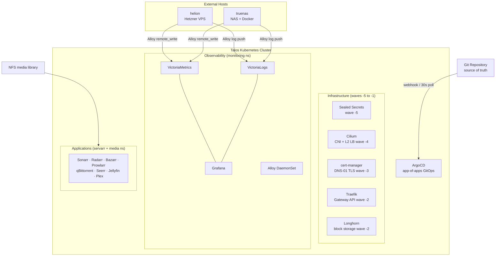

# talos-homelab

A homelab running on **Talos Linux** managed entirely through GitOps with ArgoCD. Every resource in the cluster — from CNI configuration to media server deployments — is declared in this repository. No SSH, no manual `kubectl apply` after the initial bootstrap.

[](https://www.talos.dev)
[](https://argoproj.github.io/cd/)
[](https://cilium.io)
[](https://traefik.io)
[](https://cert-manager.io)
[](https://longhorn.io)
[](https://docs.renovatebot.com)

---

## How it works

Push a commit → ArgoCD detects the change within 30 seconds and reconciles the cluster. That's the entire operations loop for almost everything.

A few key design decisions:

- **App-of-apps** — one root `Application` (`bootstrap/talos-cluster.yaml`) owns the entire cluster topology, including ArgoCD itself. After bootstrap, ArgoCD manages its own updates from git.
- **Sync waves** — infrastructure deploys in strict dependency order (secrets → CNI → TLS → ingress → apps), preventing race conditions during initial sync or a full cluster rebuild.
- **Sealed Secrets** — all `Secret` values are encrypted before commit. The private key never leaves the cluster.
- **Immutable OS** — Talos Linux exposes only an API; there is no SSH or shell access to nodes.

---

## Architecture



---

## Stack

| Component | Version | Namespace | Role |
| --- | --- | --- | --- |
| [Talos Linux](https://www.talos.dev) | latest | — | Immutable OS, API-only node access |
| [ArgoCD](https://argoproj.github.io/cd/) | 10.1.3 | `argocd` | GitOps controller, app-of-apps |
| [Cilium](https://cilium.io) | 1.19.5 | `kube-system` | CNI, L2 LoadBalancer, kube-proxy replacement |
| [cert-manager](https://cert-manager.io) | v1.21.0 | `cert-manager` | Wildcard TLS via Cloudflare DNS-01 |
| [Traefik](https://traefik.io) | 41.0.2 | `traefik` | Gateway API controller |
| [Sealed Secrets](https://github.com/bitnami-labs/sealed-secrets) | 2.19.1 | `kube-system` | Encrypt secrets for git storage |
| [Longhorn](https://longhorn.io) | 1.12.0 | `longhorn-system` | Replicated block storage |
| [VictoriaMetrics K8s Stack](https://github.com/VictoriaMetrics/helm-charts) | 0.86.0 | `monitoring` | Metrics storage, alerting, Grafana |
| [Victoria Logs](https://victoriametrics.com/products/victorialogs/) | 0.13.8 | `monitoring` | Log aggregation |
| [Grafana Alloy](https://grafana.com/oss/alloy-opentelemetry-collector/) | 1.10.1 | `monitoring` | Metrics + log collector (DaemonSet + external hosts) |
| [Metrics Server](https://github.com/kubernetes-sigs/metrics-server) | v0.8.1 | `kube-system` | `kubectl top` |
| [Renovate](https://docs.renovatebot.com) | — | — | Automated dependency PRs |

---

## Repository Layout

```text
.
├── bootstrap/
│   └── talos-cluster.yaml              ← root ArgoCD Application — applied ONCE
├── deployments/
│   ├── infrastructure/
│   │   ├── argocd/                     ← ArgoCD (self-manages after bootstrap)
│   │   ├── cert-manager/               ← Cloudflare DNS-01 issuer + wildcard cert
│   │   ├── cilium/                     ← CNI, L2 LB pool, L2 announcement policy
│   │   ├── longhorn/                   ← Distributed block storage
│   │   ├── metrics-server/
│   │   ├── observability/
│   │   │   ├── victoria-metrics-k8s-stack/  ← VMAgent, VMAlert, Grafana, dashboards, alert rules
│   │   │   ├── victoria-logs/               ← Log aggregation
│   │   │   ├── alloy/                       ← In-cluster collector DaemonSet
│   │   │   └── alloy-blackbox/              ← HTTP/TCP probe exporter
│   │   ├── sealed-secrets/
│   │   └── traefik/                    ← Gateway API controller + wildcard TLS ref
│   └── apps/
│       ├── appset-servarr.yaml         ← ApplicationSet managing all servarr apps
│       ├── homepage/                   ← Cluster service dashboard
│       ├── kubeseal-webgui/            ← Web UI for sealing secrets
│       └── <app>/                      ← Per-app folder: values file + extra manifests
├── helion/                             ← Alloy config for Hetzner VPS
├── truenas/                            ← Alloy config for TrueNAS
└── renovate.json
```

---

## Deployment Order

Applications are created in sync-wave order. ArgoCD does not wait for a child Application to be healthy before the next wave (no Application health customization is configured, on purpose: one degraded app would block every later wave). Waves set creation order only; dependencies settle through retries.

| Wave | Components | Why |
| ---: | --- | --- |
| `−5` | sealed-secrets | Must exist before any `SealedSecret` is applied |
| `−4` | cilium | CNI must be running before pods can communicate |
| `−3` | cert-manager, metrics-server | cert-manager begins issuing TLS once networking is up |
| `−2` | traefik, longhorn | Traefik depends on the wildcard cert from cert-manager |
| `−1` | argocd | Self-manages its own CRDs and configuration |
| `0` | all apps | Created after the infrastructure Applications |
| `1`–`2` | observability | VictoriaMetrics/Logs, then Alloy |

---

## Networking

### L2 LoadBalancer (Cilium)

Cilium handles `LoadBalancer` services via L2 announcements — no BGP, no MetalLB. Services get IPs from a pool on the local network, announced directly from the node holding the service.

```yaml
# L2 IP pool
start: 10.0.0.153
stop:  10.0.0.199
```

### Gateway API (Traefik)

All services use `HTTPRoute` resources pointing at the cluster gateway. Traefik exposes two listeners:

| Listener | Port | Protocol |
| --- | --- | --- |
| `web` | 80 | HTTP → redirects to HTTPS |
| `websecure` | 443 | HTTPS, wildcard TLS certificate |

Every service gets a hostname following the pattern:

```text
<service>.talos-cluster.local.obleey.com
```

### TLS

cert-manager issues and auto-renews a wildcard certificate via Cloudflare DNS-01 challenge. The certificate is stored as a `Secret` in the `traefik` namespace and referenced directly by the Gateway listener.

---

## Observability

### In-cluster stack

The cluster runs VictoriaMetrics K8s Stack + Victoria Logs in the `monitoring` namespace:

| Component | Role |
| --- | --- |
| **VMSingle** | Metrics storage — 30-day retention on a Longhorn PVC |
| **VMAgent** | Scrapes all cluster targets; accepts `remote_write` from external hosts |
| **VMAlert + VMAlertManager** | Evaluates alert rules; routes notifications to Slack |
| **Victoria Logs** | Log aggregation — receives from all Alloy agents |
| **Grafana** | Dashboards and unified alerting UI; Google SSO |
| **Alloy (DaemonSet)** | Collects node metrics, pod logs, and cAdvisor stats in-cluster |
| **Alloy Blackbox** | HTTP/TCP probes for all exposed services |

Grafana dashboards are provisioned via ConfigMap and cover node health, pod lifecycle, Traefik traffic, Longhorn storage, blackbox probe status, and media app availability.

Alert rules are defined as `VMRule` resources in the repo and cover: node CPU/memory/disk, pod OOM kills and crash loops, Longhorn volume health, cert expiry, blackbox probe failures, and media app availability.

### External hosts

Both external hosts run Grafana Alloy as a Docker container, shipping metrics and logs into the cluster.

| Host | Description |
| --- | --- |
| `helion` | Hetzner VPS — public-facing services |
| `truenas` | TrueNAS NAS — media storage, Docker apps |

Configuration lives in [`helion/`](helion/) and [`truenas/`](truenas/).

---

## Applications

All apps use the [bjw-s/app-template](https://github.com/bjw-s-labs/helm-charts) Helm chart (v5.0.1) via ArgoCD multi-source Applications. Stateful apps reference existing PVCs (`existingClaim`) so data survives redeployments.

All servarr-namespace apps are managed by a single **ApplicationSet** (`appset-servarr.yaml`) instead of individual ArgoCD Application manifests. Each app only needs a values folder in `deployments/apps/<name>/`.

| App | Namespace | Description |
| --- | --- | --- |
| [Sonarr](https://sonarr.tv) | servarr | TV show library manager |
| [Radarr](https://radarr.video) | servarr | Movie library manager |
| [Bazarr](https://www.bazarr.media) | servarr | Subtitle manager |
| [Prowlarr](https://prowlarr.com) | servarr | Unified indexer manager |
| [qBittorrent](https://www.qbittorrent.org) | servarr | Torrent client |
| [Seerr](https://github.com/Fallenbagel/jellyseerr) | servarr | Media request and discovery UI |
| [Clonarr](https://github.com/prophetse7en/clonarr) | servarr | TRaSH Guides profile syncer |
| [Autopulse](https://github.com/dan-online/autopulse) | servarr | Triggers targeted Plex/Jellyfin scans on import |
| [Byparr](https://github.com/thephaseless/byparr) | servarr | FlareSolverr drop-in replacement |
| [Unpackerr](https://github.com/davidnewhall/unpackerr) | servarr | Auto-extracts completed downloads |
| [Scraparr](https://github.com/thecfu/scraparr) | servarr | Exposes *arr app metrics for Prometheus |
| [Jellyfin](https://jellyfin.org) | servarr | Open-source media server |
| [Plex](https://www.plex.tv) | servarr | Plex Media Server |
| [Homepage](https://gethomepage.dev) | homepage | Cluster service dashboard |
| [kubeseal-webgui](https://github.com/Mahsad/kubeseal-webgui) | kubeseal-webgui | Web UI to seal new secrets |

### Media pipeline

```text
Seerr (requests)
  └──► Sonarr / Radarr ──► qBittorrent ──► Unpackerr (extract)
             │                                    │
             └──► Prowlarr (indexers)      Autopulse ──► Plex / Jellyfin
             └──► Bazarr (subtitles)              (targeted library scan)
```

All servarr and media pods share a single NFS media library mount (`/mnt/media`). Config for each app lives on individual Longhorn PVCs.

---

## Secrets Management

All secrets are encrypted with [Sealed Secrets](https://github.com/bitnami-labs/sealed-secrets) before being committed. The controller decrypts them in-cluster; the private key never leaves. If the key is lost, secrets must be resealed.

```text
kubectl create secret ... --dry-run=client -o yaml
    │
    └──► kubeseal  ──►  SealedSecret  (safe to commit)
                              │
              sealed-secrets controller decrypts in-cluster
                              │
                        Secret (available to pods)
```

**Sealing a new secret:**

```bash
kubectl create secret generic my-secret \
  --from-literal=key=value \
  -n my-namespace \
  --dry-run=client -o yaml \
  | kubeseal --format yaml > deployments/apps/my-app/my-secret-sealed.yaml
```

---

## Automated Updates

[Renovate](https://docs.renovatebot.com) watches all dependencies and opens grouped PRs. Updates must be at least 3 days old before Renovate proposes them. Major version bumps get a `major-update` label.

| Group | Tracks |
| --- | --- |
| `helm charts` | ArgoCD, Traefik, Longhorn, cert-manager, … |
| `linuxserver images` | All `lscr.io/linuxserver/*` images (sonarr, radarr, bazarr, …) |
| `ghcr images` | Seerr, Clonarr, Autopulse, Byparr, kubeseal-webgui |
| `docker hub images` | Unpackerr, Plex, Jellyfin |
| `observability stack` | victoria-metrics-k8s-stack, victoria-logs, grafana, alloy |

---

## Adding a New App

### Servarr-namespace app (managed by ApplicationSet)

1. Add `{name, port}` to `generators.list.elements` in `deployments/apps/appset-servarr.yaml` (`host` only if the subdomain differs from the name; omit `port` for apps without a web UI). The ApplicationSet injects the service port and the gateway route at `<host>.talos-cluster.local.obleey.com`.
2. Create `deployments/apps/<name>/<name>-values.yaml` with the app-specific app-template values. `deployments/apps/_common-values.yaml` is merged underneath (TZ, startup probe timing, and a 1Gi Longhorn `/config` PVC named `<name>-config` that ArgoCD never prunes; override `persistence.config.size`, or set `persistence.config.enabled: false` for stateless apps), and the NAS share is mounted with `existingClaim: starr-data` plus a `subPath`. For a homepage tile, add `gethomepage.dev/*` annotations under `route.app.annotations` (see `sonarr-values.yaml`).
3. Add a target for the hostname in `deployments/infrastructure/observability/alloy-blackbox/values.yaml`.
4. Add any extra manifests (PVCs, SealedSecrets) in the same folder.

The pre-commit hook runs `scripts/check-routes.sh` (every hostname has a probe target) and `scripts/check-conventions.py` (no cascade-delete finalizer on cluster-critical apps; each namespace comes from exactly one of a Namespace manifest or `CreateNamespace=true`). Enable it once per clone with `git config core.hooksPath .githooks`.

### Standalone app (own namespace or different lifecycle)

```text
deployments/apps/my-app/
├── app.yaml               ← ArgoCD Application (multi-source)
├── my-app-values.yaml     ← app-template Helm values
└── pvc.yaml               ← Longhorn PVC (if stateful)
```

Add `- path: deployments/apps/my-app` to `deployments/apps/kustomization.yaml` and push. ArgoCD picks it up within 30 seconds.

**`app.yaml` template:**

```yaml
apiVersion: argoproj.io/v1alpha1
kind: Application
metadata:
  name: my-app
  namespace: argocd
  labels:
    argocd.argoproj.io/managed-by: talos-cluster
  finalizers:
    - resources-finalizer.argocd.argoproj.io
spec:
  project: default
  sources:
    - repoURL: https://bjw-s-labs.github.io/helm-charts
      chart: app-template
      targetRevision: 5.0.1
      helm:
        valueFiles:
          - $values/deployments/apps/my-app/my-app-values.yaml
    - repoURL: https://github.com/YOUR_USER/talos-homelab
      targetRevision: HEAD
      ref: values
  destination:
    server: https://kubernetes.default.svc
    namespace: my-namespace
  syncPolicy:
    automated:
      prune: true
      selfHeal: true
```

---

## Outside Git

A rebuild needs these, and the repo does not hold them:

| What | Where it lives |
| --- | --- |
| Talos machine configs (node names, `.160`/`.161` IPs) | Generated with `talosctl`; not in git yet |
| sealed-secrets controller private key | Password manager. Without it every `*-sealed.yaml` is unreadable; see restore below |
| NFS exports `/mnt/serve/starr-stack/data`, `/mnt/serve/longhorn-backups` | TrueNAS at `10.0.0.104` |
| Technitium primary DNS | `10.0.0.104:5380` |
| `*.talos-cluster.local.obleey.com` → gateway LB IP | DNS record on Technitium |
| ArgoCD `obleey`/`readonly` passwords, homepage ArgoCD token | Set in the ArgoCD UI; token sealed into `homepage-secrets` |

**Back up the sealing key** (once, and after any key rotation):

```bash
kubectl -n kube-system get secret -l sealedsecrets.bitnami.com/sealed-secrets-key -o yaml > sealed-secrets-key.yaml
# store in the password manager, then delete the file
```

**Restore it** on a new cluster before bootstrap step 3, so the committed SealedSecrets decrypt:

```bash
kubectl apply -f sealed-secrets-key.yaml
kubectl -n kube-system delete pod -l app.kubernetes.io/name=sealed-secrets  # picks up the restored key
```

With a restored key, skip bootstrap step 1: the committed sealed files already match.

---

## Bootstrap

> One-time process. After this, ArgoCD manages everything from git.

### Prerequisites

- Talos cluster running with `kubeconfig` configured
- `helm` ≥ 3.x and `kubeseal` CLI installed
- Cloudflare account with DNS API access
- A public git repository (a private one also needs an ArgoCD repository Secret: label `argocd.argoproj.io/secret-type: repository`, keys `url`, `username`, `password`)

### Steps

#### 1. Seal your credentials

```bash
# Cloudflare API token (cert-manager DNS-01)
kubectl create secret generic cloudflare-api-token \
  --from-literal=api-token=<YOUR_TOKEN> \
  -n cert-manager --dry-run=client -o yaml \
  | kubeseal --format yaml \
  > deployments/infrastructure/cert-manager/cloudflare-api-token-sealed.yaml
```

#### 2. Install ArgoCD

```bash
helm repo add argo https://argoproj.github.io/argo-helm
helm repo update
kubectl create namespace argocd
helm install argocd argo/argo-cd \
  -n argocd \
  -f deployments/infrastructure/argocd/argocd-values.yaml
```

#### 3. Apply the root app — the last manual step

```bash
kubectl apply -f bootstrap/talos-cluster.yaml
```

ArgoCD reconciles the full cluster from git, creating Applications in sync-wave order (see [Deployment Order](#deployment-order)).

---

## Adapting to Your Cluster

| File | What to change |
| --- | --- |
| `cilium/loadbalancer-pool.yaml` | L2 IP range for LoadBalancer services |
| `cilium/l2-announcement-policy.yaml` | Network interface name (`ip link`) |
| `cilium/cilium-values.yaml` | `k8sServiceHost` and `k8sServicePort` |
| `cert-manager/cert-manager-cluster-issuer.yaml` | Domain and Let's Encrypt email |
| `traefik/wildcard-cert.yaml` | Domain names |
| `argocd/argocd-values.yaml` | ArgoCD external URL |
| All `HTTPRoute` manifests | Hostnames |
| All `*-values.yaml` with NFS paths | NFS server IP |
| `bootstrap/talos-cluster.yaml` and all `app.yaml` | Your git repository URL |
| All sealed secrets | Re-seal with your cluster's public key |

---

## Operations Reference

```bash
# App sync status
kubectl get applications -n argocd

# Resource usage
kubectl top nodes && kubectl top pods -A

# Force-refresh an app (bypass cache)
argocd app get <app-name> --hard-refresh

# Reload Grafana dashboard provisioning
kubectl exec -n monitoring deploy/kps-grafana -c grafana -- \
  wget -qO- --post-data='' \
  http://localhost:3000/api/admin/provisioning/dashboards/reload

# Seal a new secret
kubectl create secret generic my-secret \
  --from-literal=key=value \
  -n my-namespace --dry-run=client -o yaml \
  | kubeseal --format yaml > path/to/sealed.yaml

# Rebuild cluster from scratch (after hardware reset)
helm install argocd argo/argo-cd -n argocd \
  -f deployments/infrastructure/argocd/argocd-values.yaml
kubectl apply -f sealed-secrets-key.yaml   # from the password manager, see Outside Git
kubectl apply -f bootstrap/talos-cluster.yaml
# ArgoCD restores full cluster state from git
```

---

## License

MIT
