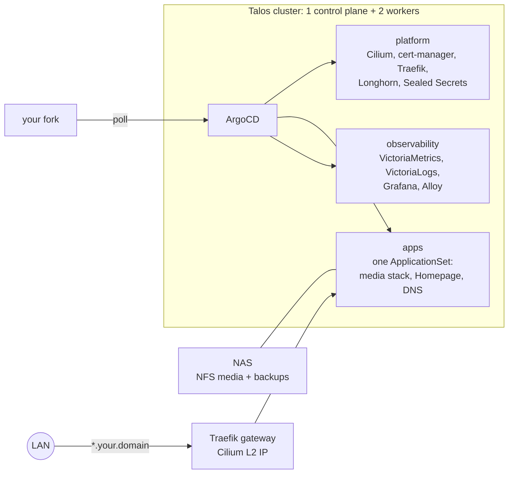

# talos-homelab

A GitOps blueprint for a homelab on [Talos Linux](https://www.talos.dev): three nodes, one Git repository, and [ArgoCD](https://argoproj.github.io/cd/) applying whatever is in it. After a one-time bootstrap you never run `kubectl apply` again; every change is a commit.

It's a working setup, not a template generator. Fork it, replace the values that are mine (domain, IPs, NAS, accounts), delete the apps you don't want, and bootstrap. This README walks through exactly that.



## What you get

- **Talos + Cilium** without kube-proxy, LoadBalancer IPs announced on your LAN by Cilium L2. No MetalLB.
- **HTTPS everywhere:** one Let's Encrypt wildcard certificate (Cloudflare DNS-01) on a Traefik Gateway API gateway. Every app is `https://<app>.<your domain>`, even on a LAN-only domain.
- **Storage:** Longhorn replicated volumes with daily snapshots and weekly backups to NFS, plus a shared NFS media share.
- **Secrets in Git:** Sealed Secrets, so the whole cluster state, credentials included, lives in the repo.
- **Apps with almost no YAML:** one ApplicationSet over the bjw-s [app-template](https://github.com/bjw-s-labs/helm-charts) chart. Adding an app is one list entry and one values file; Service, route, TLS and a 1Gi config volume come for free.
- **Observability:** VictoriaMetrics and VictoriaLogs (30 days), Grafana with vendored dashboards, Grafana-managed alerts to Slack, and a blackbox probe for every hostname you serve.
- **Guard rails:** a lint that catches the mistakes this repo has actually made (unprobed hostnames, missing secret keys, alerts that can't fire, …), a render check of every chart in CI, and Renovate for weekly version bumps.

### What runs

| Layer | Components |
| --- | --- |
| Platform | Cilium, cert-manager, Traefik, Longhorn, Sealed Secrets, ArgoCD (manages itself), metrics-server, kubelet-serving-cert-approver |
| Media | Sonarr, Radarr, Prowlarr, Bazarr, qBittorrent, Unpackerr, Seerr, Plex, Jellyfin, Clonarr, WatchState, Autopulse, Byparr, Scraparr |
| Tools | Homepage (start page with live widgets), Forgejo (Git + Actions runners), kubeseal-webgui, Technitium secondary DNS, NetBird routing peer (remote access) |
| Observability | VictoriaMetrics k8s stack (VMSingle, VMAgent, Grafana), VictoriaLogs, Alloy (logs, events, blackbox probes) |

Every version is pinned in its Application's `targetRevision` (or image tag) and bumped by Renovate, so none are listed here.

## Repository layout

```text
bootstrap/talos-cluster.yaml     root Application, applied once; owns everything under deployments/
deployments/
  infrastructure/<component>/    app.yaml (chart + this repo as values source), values, extra manifests
    observability/               metrics, logs, Grafana (alerts/ and dashboards/ as ConfigMaps), Alloy
  apps/
    appset-servarr.yaml          the ApplicationSet: one list element per app-template app
    _common-values.yaml          defaults merged under every element
    <app>/<app>-values.yaml      per-app values, plus any extra manifests in the same folder
    forgejo/, kubeseal-webgui/   standalone Applications (own chart)
scripts/                         lint.py, test_lint.py, render-check.py
docs/adr/                        decisions later changes shouldn't undo
```

## Before you start

**Hardware and network**

- Three machines for Talos (this repo: one control plane, two workers) on one L2 network.
- A free range of LAN IPs for LoadBalancer services, outside your DHCP range.
- A NAS with NFS: one export for media and downloads, one for Longhorn backups. Plex and Jellyfin also use a `local-path` StorageClass for their cache.

**Accounts**

- A domain on Cloudflare and an API token with `Zone:DNS:Edit` on it. The domain only needs to resolve on your LAN; Cloudflare is used for the DNS-01 challenge, not for serving.
- Optional: a Slack bot token (alerts), Google OAuth clients (ArgoCD and Grafana login), a NetBird account, an SMTP provider for Forgejo, an off-site restic repo for Forgejo backups.

**Tools on your workstation:** `talosctl`, `kubectl`, `helm`, `kubeseal`, Python 3 with PyYAML.

## Setup

### 1. Fork and make it yours

Two values appear in many files: the repo URL that ArgoCD pulls from, and the base domain every app is served under. Replace both across the repo:

```bash
git grep -l 'obleey/talos-homelab' | xargs sed -i '' 's|obleey/talos-homelab|<you>/<repo>|g'
git grep -l 'talos-cluster.local.obleey.com' | xargs sed -i '' 's|talos-cluster\.local\.obleey\.com|<your.domain>|g'
```

(On Linux drop the `''` after `-i`.) Then go through the rest by hand:

| What | Where |
| --- | --- |
| LoadBalancer IP range | `infrastructure/cilium/loadbalancer-pool.yaml` |
| NIC Cilium announces on (`eno1`) | `infrastructure/cilium/l2-announcement-policy.yaml` |
| Let's Encrypt email; wildcard certificate names | `cert-manager/cert-manager-cluster-issuer.yaml`, `traefik/wildcard-cert.yaml` |
| NAS address and export paths | `apps/starr-data.yaml`, `longhorn/backuptarget.yaml` |
| Timezone | `apps/_common-values.yaml` and `git grep Europe/Ljubljana` |
| Google OAuth client IDs, allowed emails, ArgoCD users and RBAC | `argocd/argocd-values.yaml`, `victoria-metrics-k8s-stack/values.yaml` |
| Things outside the cluster (TrueNAS, Technitium primary, NetBird URL) | `homepage/homepage-values.yaml` `services.yaml` |
| Fixed IP for the secondary DNS | `technitium-secondary/technitium-secondary-values.yaml`, its probe in `alloy-blackbox/values.yaml` |

Don't want an app? See [Removing an app](#removing-an-app); doing it now saves sealing secrets for it.

### 2. Install Talos

Build an installer image on the [Image Factory](https://factory.talos.dev) with the `siderolabs/iscsi-tools` and `siderolabs/util-linux-tools` extensions (Longhorn needs both), then generate configs with this patch for every node:

```yaml
cluster:
  network:
    cni:
      name: none          # Cilium is the CNI
  proxy:
    disabled: true        # Cilium replaces kube-proxy (talks to the API via KubePrism on :7445)
machine:
  kubelet:
    extraArgs:
      rotate-server-certificates: true   # kubelet-serving-cert-approver signs these; metrics-server needs them
    extraMounts:
      - destination: /var/lib/longhorn
        type: bind
        source: /var/lib/longhorn
        options: [bind, rshared, rw]
```

```bash
talosctl gen config <cluster-name> https://<control-plane-ip>:6443 \
  --install-image <image-factory-installer> --config-patch @patch.yaml
talosctl apply-config --insecure -n <node-ip> --file controlplane.yaml   # or worker.yaml
talosctl bootstrap -n <control-plane-ip>
talosctl kubeconfig -n <control-plane-ip>
```

See Talos's [Cilium](https://www.talos.dev/latest/kubernetes-guides/network/deploying-cilium/) and [Longhorn](https://longhorn.io/docs/latest/advanced-resources/os-distro-specific/talos-linux-support/) guides for details. Nodes stay `NotReady` until the next step installs a CNI.

### 3. Bootstrap

Nothing schedules without a CNI, and ArgoCD can't install one before it's running itself. So Cilium and ArgoCD go in by hand once, with the repo's own values; ArgoCD then adopts both.

```bash
# Cilium (version from deployments/infrastructure/cilium/app.yaml)
helm repo add cilium https://helm.cilium.io
helm install cilium cilium/cilium -n kube-system --version <version> \
  -f deployments/infrastructure/cilium/cilium-values.yaml

# ArgoCD (version from deployments/infrastructure/argocd/app.yaml)
helm repo add argo https://argoproj.github.io/argo-helm
kubectl create namespace argocd
helm install argocd argo/argo-cd -n argocd --version <version> \
  -f deployments/infrastructure/argocd/argocd-values.yaml

# Hand the cluster to Git
kubectl apply -f bootstrap/talos-cluster.yaml
```

ArgoCD now creates everything in sync-wave order: sealed-secrets first, then Cilium, cert-manager, Traefik and Longhorn, then itself, the apps, and observability. Watch it with `kubectl -n argocd get applications`. Anything that needs a secret stays degraded until step 4.

**Rebuilding an existing cluster?** Restore the old sealing key before `talos-cluster.yaml` (`kubectl apply -f sealed-secrets-key.yaml`) and every committed secret decrypts as-is; skip step 4.

### 4. Seal your secrets

The `*-sealed.yaml` files in this repo are encrypted for my cluster, so yours can't read them. Once the sealed-secrets controller is up, re-create each one with your own values:

```bash
kubectl create secret generic cloudflare-api-token -n cert-manager \
  --from-literal=api-token=<token> --dry-run=client -o yaml \
  | kubeseal --controller-namespace kube-system --controller-name sealed-secrets-controller --format yaml \
  > deployments/infrastructure/cert-manager/cloudflare-api-token-sealed.yaml
```

Keep the secret name, namespace and keys of the file you're replacing (they're readable in plain text in it); the lint checks that every key a workload references exists. The ones you need:

| Secret | For | Needed |
| --- | --- | --- |
| `cloudflare-api-token` | Wildcard certificate | Yes |
| `servarr-credentials` | *arr API keys shared by Homepage, Scraparr, Unpackerr, Autopulse | With the media stack |
| `kps-grafana`, `prometheus-basic-auth`, `loki-basic-auth` | Grafana admin login; push endpoints for hosts outside the cluster | With observability |
| `homepage-secrets` | Widget tokens (ArgoCD, Technitium, TrueNAS, Forgejo, Grafana) | With Homepage |
| `grafana-slack-token`, `argocd-notifications-secret` | Slack alerts and sync notifications | Optional |
| `grafana-google-oauth`, `argocd-google-oauth` | Google login | Optional |
| `forgejo-*`, `unpackerr-ui`, `autopulse-secret`, `netbird-mgmt-api-key` | Those apps | If you keep them |

Commit, push, and ArgoCD picks them up. Then back up the sealing key; without it, every sealed file in the repo is unreadable after a rebuild:

```bash
kubectl -n kube-system get secret -l sealedsecrets.bitnami.com/sealed-secrets-key -o yaml > sealed-secrets-key.yaml
# store in your password manager, then delete the file
```

kubeseal-webgui (`https://kubeseal.<your.domain>`) does the same from a browser.

### 5. Point DNS at the gateway

Traefik gets the first IP from the Cilium pool:

```bash
kubectl -n traefik get svc traefik -o jsonpath='{.status.loadBalancer.ingress[0].ip}'
```

Create a wildcard record `*.<your.domain>` pointing at it on your LAN DNS server. Once cert-manager has the certificate (`kubectl -n traefik get certificate`), `https://hub.<your.domain>` shows Homepage with a tile for every app.

### 6. Turn on the checks

```bash
git config core.hooksPath .githooks   # lint + lint self-test before every commit
```

CI (`.github/workflows/checks.yaml`) runs the same plus a render of every chart, and posts failures to Slack when the `SLACK_BOT_TOKEN` repo secret is set. Install the [Renovate](https://docs.renovatebot.com) GitHub app on your fork for weekly update PRs.

## Day to day

### Adding an app

Most apps go through the ApplicationSet:

1. Add an element to `deployments/apps/appset-servarr.yaml`: `name`, and `port` if it has a web UI. A port gets a Service and the route `https://<name>.<your.domain>`; set `host` for a different subdomain and `namespace` to leave `servarr` (then add a `namespace.yaml` to its folder).
2. Create `deployments/apps/<name>/<name>-values.yaml` with at least the image. `_common-values.yaml` already gives it the timezone, a `Recreate` strategy and a 1Gi Longhorn `/config` volume (`persistence.config.size` to change, `persistence.config.enabled: false` if stateless). Mount the media share with `existingClaim: starr-data` and a `subPath`. `sonarr-values.yaml` is a complete example.
3. Add the hostname to the blackbox targets in `observability/alloy-blackbox/values.yaml`. The lint fails until you do.
4. Put any extra manifests (SealedSecrets, PVCs) in the app's folder; the ApplicationSet applies them.

For a Homepage tile, add `gethomepage.dev/*` annotations under `route.app.annotations`. app-template runs values through `tpl`, so Homepage's own placeholders are escaped: `'{{ "{{HOMEPAGE_VAR_X}}" }}'`.

An app with its own Helm chart becomes a standalone Application instead: a folder with `app.yaml` (two sources: the chart, and this repo as `ref: values`), the values file and manifests, listed in `deployments/apps/kustomization.yaml`. Copy `kubeseal-webgui/`.

### Removing an app

Delete its element from `appset-servarr.yaml` (or its line in a `kustomization.yaml`), its folder, its blackbox target, and any keys only it used. `scripts/lint.py` tells you what still points at it. Config volumes are never pruned (`Prune=false,Delete=false`), so delete the leftover PVC by hand once you're sure.

### Changing a secret

To add or rotate one key in an existing SealedSecret, seal just that value and replace its line under `encryptedData`; the other keys stay valid:

```bash
printf %s '<value>' | kubeseal --raw --namespace <ns> --name <secret>
```

Pods read secrets at start: restart the consumers after a rotation.

### Useful commands

```bash
kubectl -n argocd get applications                                                       # sync and health of everything
kubectl -n argocd annotate application <app> argocd.argoproj.io/refresh=normal --overwrite   # re-read Git now
kubectl -n servarr rollout restart deploy/homepage                                       # after Homepage config changes (subPath mounts don't update)
```

## How it fits together

- **Sync waves** order creation: sealed-secrets `-5`, Cilium `-4`, cert-manager and metrics-server `-3`, Traefik and Longhorn `-2`, ArgoCD `-1`, apps `0`, metrics and logs `1`, Alloy `2`. ArgoCD doesn't wait for health between waves (on purpose: one degraded app would block the rest); dependencies settle through retries.
- **Cluster-critical Applications have no cascade-delete finalizer** (sealed-secrets, Cilium, cert-manager, ArgoCD, Longhorn): deleting the Application leaves the component running.
- **Each namespace is created exactly once:** a `Namespace` manifest or `CreateNamespace=true`, never both.
- **Shared credentials live once:** API keys several apps use are keys in `servarr-credentials`, read with `secretKeyRef`.
- **Homepage tiles are route annotations.** Only things without a route in this cluster (NAS, primary DNS, VPN) are in Homepage's `services.yaml`. Set `gethomepage.dev/pod-selector` when pods aren't labelled `app.kubernetes.io/name=<route name>`.
- **Observability:** VMAgent scrapes nodes, kube-state-metrics and every chart's ServiceMonitor. Alloy ships pod logs and Kubernetes events and redacts tokens and passwords before they leave the node. Hosts outside the cluster push to `prometheus.` and `loki.` behind basic auth. Alerts are Grafana-managed rules in `victoria-metrics-k8s-stack/alerts/`; VMAlert only evaluates recording rules. Dashboards are vendored ConfigMaps ([ADR 0001](docs/adr/0001-vendor-grafana-dashboards.md)).
- **Alert rules:** query the raw metric and put the comparison in the threshold (`lt 1` for "down"); use `$values.A.Value` in text (`$value` is a string of every result); a `__dashboardUid__` always comes with a `__panelId__`.

### Checks

| Script | Runs in | Catches |
| --- | --- | --- |
| `scripts/lint.py` | pre-commit, CI | YAML that doesn't parse or has duplicate keys; hostnames without a probe and probes without a host; `secretKeyRef` keys missing from their SealedSecret; undefined `HOMEPAGE_VAR_*`; in-cluster URLs whose port disagrees with the ApplicationSet; alerts that can never fire or link to missing dashboards; the conventions above |
| `scripts/test_lint.py` | pre-commit, CI | Breaks a copy of the repo once per check and asserts the check fires |
| `scripts/render-check.py` | CI | `helm template` for every chart Application and ApplicationSet element, plus `kubectl kustomize deployments` |

### Gotchas

- **Grafana alert provisioning is all-or-nothing:** one invalid rule fails every reload, and the previous rules keep running. Rules removed from the files stay in Grafana unless listed under `deleteRules` in `alerts/grafana-alerting.yaml`.
- **Renaming an Application, or moving one between the root app and the ApplicationSet:** remove the live Application's finalizer first, or pruning the old one deletes the workload.
- **Pod selectors are immutable:** a chart change that alters them needs the old Deployment deleted once; ArgoCD recreates it.

## Backups and what Git doesn't hold

| What | Where it lives |
| --- | --- |
| Sealed-secrets private key | Your password manager (step 4). Without it, a rebuild means re-sealing everything |
| Talos machine configs and `talosconfig` | Generated in step 2; keep them with the key |
| App config volumes | Longhorn: daily snapshots (7 kept), weekly backups to the NFS backup target (4 kept) |
| Forgejo | Longhorn daily backup, plus a nightly restic backup off-site (`forgejo/backup.yaml`) with a stale-backup alert |
| `local-path` provisioner (Plex/Jellyfin cache) | Installed by hand |
| NFS exports, LAN DNS and its wildcard record | The NAS and DNS server |
| Alloy on hosts outside the cluster | Those hosts |

In this setup the NAS is TrueNAS (NFS, Technitium primary DNS), a VPS called `helion` pushes its metrics and logs into the cluster, and Forgejo's off-site backups go to a Hetzner Storage Box. None of that is required: drop the matching scrape targets, alerts and Homepage entries if you don't have it.

## License

MIT
